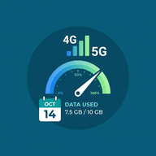

<div align="center">



# Previsor de Datos Móviles

Predice si tu paquete de datos móviles te alcanzará para el resto del ciclo,
según tu saldo restante, los días transcurridos y tu ritmo de consumo.


</div>

---

## ✨ Características

- **Dos líneas independientes**: una línea mensual (ciclo de calendario) y una
  línea prepago de 35 días (conteo desde la compra).
- **Pronóstico de agotamiento**: calcula el ritmo de consumo diario, la cuota
  diaria segura y el día del ciclo en que se agotará el saldo.
- **Semáforo de riesgo**: `Sobrante`, `En ritmo`, `Riesgo de agotarse`,
  `Crítico`.
- **Simulador what-if**: "¿y si consumo X MB al día, me alcanza?"
- **Estimación por actividad**: cuántos minutos/día de video HD, redes
  sociales, música o WhatsApp puedes permitirte.
- **Lecturas USSD automáticas**: guarda tu código USSD por operador, márcalo
  con un toque (la app disca directo con permiso de llamada) y el lector de
  respuestas captura el texto del operador, detecta el saldo (GB/MB, con coma
  o punto: "4.2 GB", "2,5GB", "10 gigas", "850 megas"...) y en la línea
  prepago también los días restantes ("le quedan 20 días", "válido hasta
  25/11"), actualizando el día del ciclo automáticamente. El lector usa un
  servicio de accesibilidad que solo lee la pantalla durante la consulta.
  Todo sigue disponible a mano como respaldo.
- **Historial de lecturas** por línea, con notas, editable manualmente.
- **Persistencia local** con Room (sin cuentas, sin servicios externos).

## 🏗️ Arquitectura

MVVM con Jetpack Compose, organizado por capas:

```
app/src/main/java/com/example/
├── MainActivity.kt                  # Host + navegación por pestañas
├── data/
│   ├── local/       AppDatabase, DataDao        (Room)
│   ├── model/       DataPlanEntity, DataBalanceLogEntity
│   └── repository/  DataPlanRepository          (fuente única de datos)
├── domain/                          # Lógica pura, sin Android
│   ├── DataForecastCalculator       # Pronóstico, cuotas, semáforo
│   └── UssdParser                   # Parser de respuestas USSD/SMS
└── ui/
    ├── components/                  # Cards, dialogs, formatters
    ├── screens/                     # Forecast, Prepago 35d, Logs, Ajustes
    ├── theme/
    └── viewmodel/                   # DataForecastViewModel (StateFlow)
```

## 🛠️ Compilar

Requisitos: JDK 17+ y el Android SDK (API 36).

```bash
./gradlew assembleDebug          # APK debug en app/build/outputs/apk/debug/
./gradlew assembleRelease         # firma con KEYSTORE_PATH/STORE_PASSWORD/KEY_PASSWORD
```

> El primer `./gradlew` descarga automáticamente Gradle 9.3.1 vía el wrapper.

Instalar en un dispositivo conectado:

```bash
adb install app/build/outputs/apk/debug/app-debug.apk
```

## 🧪 Tests

```bash
./gradlew testDebugUnitTest
```

Cubren el motor de pronóstico (`DataForecastCalculator`) y el parser USSD
(`UssdParser`) con JUnit.

## 📦 Descargas

Los APK firmados se publican como
[Releases](https://github.com/renehdezalvarez/datos_android/releases), no en
el historial de git.

## 📄 Licencia

Sin licencia definida por ahora (repositorio privado). Si decides abrirlo,
MIT/Apache-2.0 serían opciones típicas.
